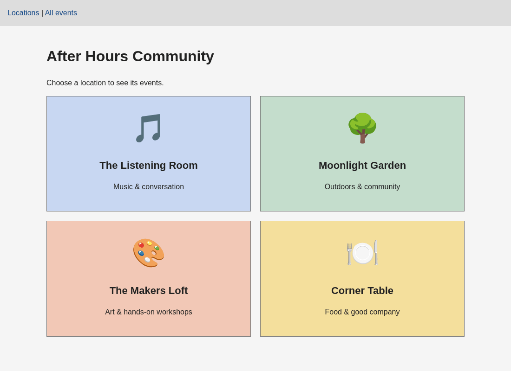

# WEB103 Project 3 - After Hours Community

Submitted by: **Kavya Gautam**

This web app is a virtual community space where users can choose one of four locations and view its events.

## About this web app

After Hours Community has a music room, garden, art workshop, and community kitchen. React displays locations and events from an Express API connected to Render PostgreSQL.

Time spent: Not tracked.

## Required Features

The following **required** functionality is completed:

- [x] The web app uses React to display data from the API.
- [x] The web app is connected to a PostgreSQL database.
- [x] The web app is connected to a Render PostgreSQL database.
- [x] The database contains an appropriately structured events table.
- [x] The front page is functional and styled.
- [x] The web app displays a title.
- [x] The website includes a visual interface for selecting at least four locations.
- [x] Each location has a detail page with its own unique URL.
- [x] Clicking a location displays all events associated with that location from the events table.

## Stretch Features

- [x] An additional Events page shows all events.
- [x] Users can filter events by location.
- [x] Events display a countdown until their start time.
- [x] Past events use different formatting and display "Past event".

## Video Walkthrough



## Notes

There are four locations and twelve sample events, including past and upcoming events. Each event references a location through a foreign key. Event times display in Central Time. Database credentials are stored in an ignored `.env` file.

## Setup / Run

```bash
npm install
cp .env.example .env
```

Fill in `DATABASE_URL` using the external database URL from Render. Keep `PGSSLMODE=require`. If a configured `.env` already exists, keep it.

```bash
npm run db:seed
npm run dev
```

Open http://127.0.0.1:5173. The API runs on port 3003.

```bash
npm test
npm run build
npm start
```

The tests check the countdown and the actual database API. They also run the seed twice to check that sample data is not duplicated. `npm start` serves the production build at http://localhost:3003.

## License

    Copyright 2026 Kavya Gautam

    Licensed under the Apache License, Version 2.0 (the "License");
    you may not use this file except in compliance with the License.
    You may obtain a copy of the License at

        http://www.apache.org/licenses/LICENSE-2.0

    Unless required by applicable law or agreed to in writing, software
    distributed under the License is distributed on an "AS IS" BASIS,
    WITHOUT WARRANTIES OR CONDITIONS OF ANY KIND, either express or implied.
    See the License for the specific language governing permissions and
    limitations under the License.
